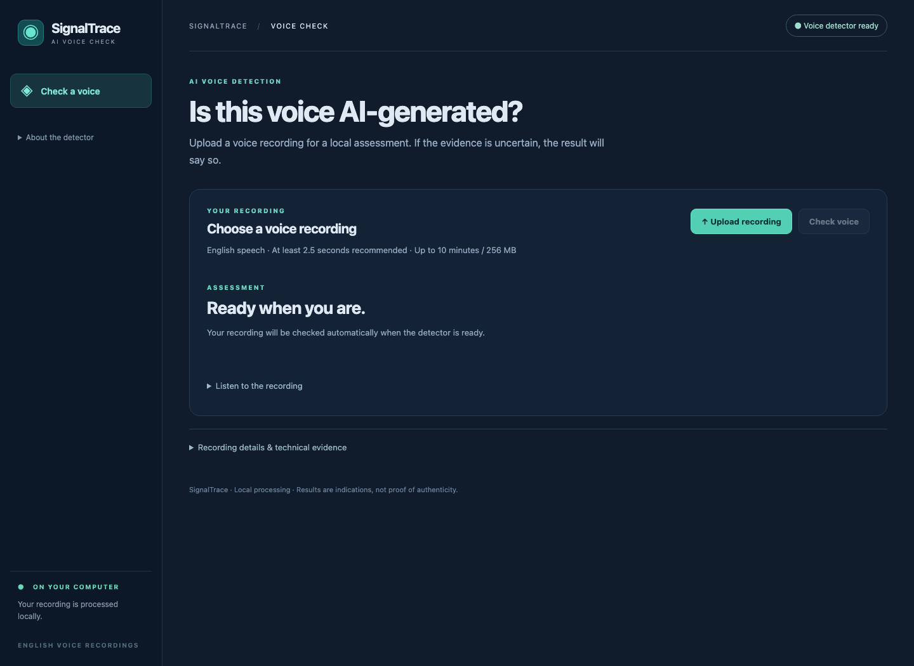
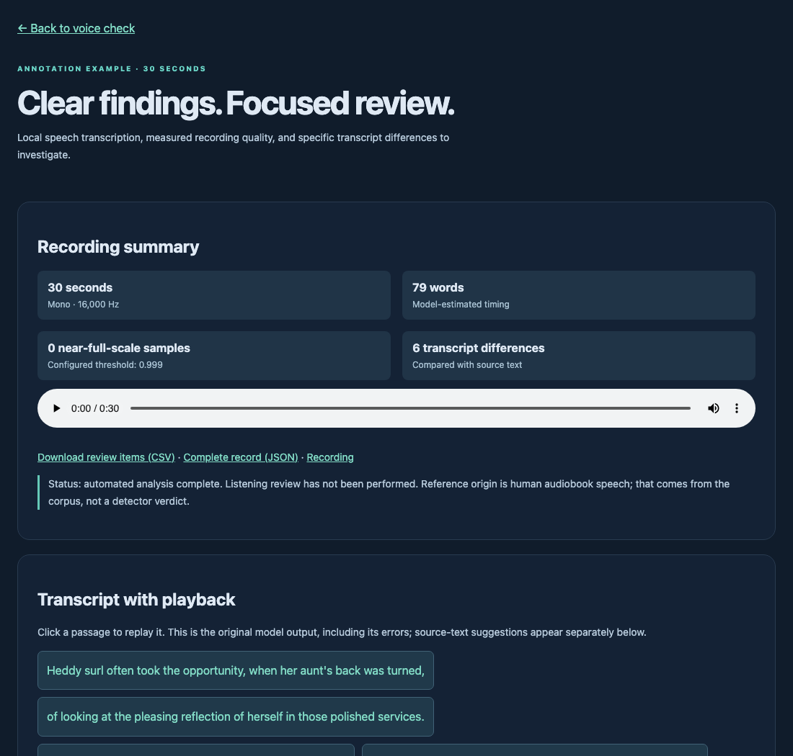

# SignalTrace

**Local AI-voice detection and speech-annotation tooling, with documented evaluations and known failure modes.**

[](https://github.com/kter1/audio-evaluation-workbench/actions/workflows/ci.yml)




Upload a voice recording and SignalTrace returns one of three results, **AI voice indicated**, **No clear AI signal**, or **Inconclusive**, with the reasons behind it. Everything runs on your machine. No audio goes to a hosted service, and models are never downloaded without an explicit setup step.

The repository also has a blind annotation workspace for labeling real versus cloned speech to a written guide, and the evaluation records behind every detector claim: what was tested, what failed, and what remains unknown.

## Contents

- [Features](#features)
- [Quick start](#quick-start)
- [Results](#results)
- [Annotation workflow](#annotation-workflow)
- [Limitations](#limitations)
- [Repository layout](#repository-layout)
- [Development](#development)
- [Data, models, and licensing](#data-models-and-licensing)

## Features

- **A clear verdict, with an honest "Inconclusive."** Recordings that are too short, silent, clipped, or phase-cancelled are flagged before the model runs. A verdict that flips under small perturbations is reported as Inconclusive. A human result requires both component models to agree.
- **Two-model detector.** Fuses [PellaV2](https://huggingface.co/Sadanie/pellav2-audio-deepfake-detector) and NII [AntiDeepfake](https://huggingface.co/nii-yamagishilab/mms-300m-anti-deepfake). Both ports are parity-checked against their official code, and every checkpoint is verified against a pinned SHA-256 before it loads.
- **Acoustic evidence markers.** Clipping, gaps, level jumps, spectral shifts, DC offset, limited bandwidth, and stereo problems are marked on the waveform. Each marker states its rule, measurement, timestamps, limitations, and a suggested next check.
- **Analyst notes and exports.** Recording details, model evidence, and notes export as JSON and printable HTML reports.
- **Annotated sample.** A 30-second LibriSpeech excerpt with word-level timestamps, transcript differences, and quiet-interval annotations, viewable without any model download.
- **Blind annotation workspace.** A separate app for structured, guide-driven labeling with frozen judgments, delayed blind repeats, and second-reviewer packages ([details](#annotation-workflow)).

## Quick start

Requires Python 3.11–3.13 (CI uses 3.13) on macOS or Linux.

```sh
git clone https://github.com/kter1/audio-evaluation-workbench.git
cd audio-evaluation-workbench
sh run.sh
```

Open **http://127.0.0.1:8501**. The first run creates `.venv/` and installs the lightweight app dependencies. If `python3` is older than 3.11, run `PYTHON=python3.13 sh run.sh` instead.

The interface, signal measurements, and annotated sample (at `/samples/annotation-example.html`) work right away. To enable AI-voice detection, install the detector once (about 2.5 GB of checkpoints):

```sh
.venv/bin/python -m pip install -r requirements.txt
.venv/bin/python scripts/setup_pellav2.py
.venv/bin/python scripts/setup_antideepfake.py
```

Then refresh the page; the status badge changes to **Voice detector ready**. After that, inference runs offline on CPU. The [app guide](docs/app-guide.md) covers input limits, result details, and the evidence markers.

## Results

The detector was frozen before each test below, with no threshold tuning on test data.

**Frozen test of 320 clips from 73 speakers.** The set is English read speech: 200 genuine recordings and 120 clones from three open TTS generators. Sixty of the clones come from XTTS-v2, which was held out of development entirely.

| Channel | Clones detected | Genuine recordings flagged |
| --- | ---: | ---: |
| Clean | 120 / 120 | 0 / 200 |
| MP3, 64 kbps | 120 / 120 | 3 / 200 (1.5%) |
| Telephone, 8 kHz µ-law | 120 / 120 | 5 / 200 (2.5%) |
| White noise, 20 dB SNR | 119 / 120 | 10 / 200 (5.0%) |

The same 320 source clips are reused across all four channels, so the rows are correlated. That set has since been used for regression checks, and it is no longer an untouched test. Full protocol: [detector evaluation](docs/model-evaluation.md).

**Newer generators.** On a 45-clip screen covering five recent TTS systems (Chroma, GLM-TTS, Qwen3-TTS, VibeVoice, VoxCPM), the detector flagged 25/25 clean synthetic clips with no false alerts on 20 human clips. Under added noise it flagged 19/25 and gave two wrong human verdicts; the corroboration rule now turns both into Inconclusive. See [core detector progress](docs/core-detector-progress.md).

**What did not work.** Each of these was tested and rejected, with numbers:

- MetricGAN speech enhancement reached 25/25 on noisy clones but falsely flagged all 20 noisy human clips.
- A compact noise-augmented classifier (RawNetLite) and a third pretrained classifier both missed too many clones.
- Logit clipping before fusion raised false alerts.

See the [research log](docs/research-log.md) for the full sequence.

## Annotation workflow

Two pieces of the repository are built around careful human labeling.

**Annotated sample** (in SignalTrace at `/samples/annotation-example.html`). The 30-second LibriSpeech excerpt has 79 estimated word timestamps from local speech recognition and six specific differences from the source text. It also has grouped quiet intervals and CSV/JSON exports. Its provenance and measurements are in [annotation-demo.json](studio/dist/samples/annotation-demo.json).

<p align="center"></p>

**Blind annotation workspace** (`sh run-legacy.sh`). A Streamlit app for labeling real versus AI-cloned speech under blind conditions:

- A versioned [annotation guide](docs/annotation-guide.md) defines intelligibility, interference tags (noise, codec artifacts, reverb, hold audio, clipping, dropouts), perceptual cues, origin (human, synthetic, or uncertain with a required explanation), confidence, timestamped observations, and escalation.
- Labels, scores, and file names stay hidden during review. Submitted judgments are frozen; corrections and adjudications are stored beside the original and never overwrite it.
- Twenty clips return as blind repeats at least 48 hours later to measure self-agreement (Cohen's kappa).
- Blind packages (neutral WAVs, no metadata) go to a second reviewer, and their returned labels are compared before adjudication.
- After reveal, a quality-review queue surfaces disagreements, detector misses, and escalations as short case studies. Everything exports as spreadsheet-ready CSV, with [SQL examples](docs/queries.sql) for the underlying SQLite data.

The study design, research setup, and CLI are in the [annotation workspace guide](docs/annotation-workspace.md) and [study protocol](docs/study-protocol.md). No personal annotation results or inter-reviewer agreement figures have been published yet.

## Limitations

- **Short inserts can be missed.** In a constructed test, all four one-second AI segments spliced into 12-second genuine recordings were read as human. A **No clear AI signal** result does not certify human origin.
- **Scores are not probabilities.** Model outputs are not calibrated authenticity probabilities.
- **Limited scope.** All testing so far is English read speech, open generators, and simulated channels. No results are claimed for commercial voice-cloning services, live phone calls, replayed audio, or music.
- **Single local user.** The app binds to `127.0.0.1` with no authentication. Do not expose it to a network. See the [security review](docs/security-review.md).
- **Not a forensic tool.** SignalTrace does not establish fraud, identify speakers, or evaluate any vendor's production system.

## Repository layout

```text
signaltrace_server.py   Local web API and static host for SignalTrace
studio/dist/            Browser front end (no build step) and the annotated sample
app.py                  Blind annotation workspace (Streamlit)
lab/                    Detection, signal measurement, annotation, and evaluation code
scripts/                Model setup, data acquisition, and evaluation runners
tests/                  pytest suite and front-end tests (node:test)
docs/                   Guides, evaluation reports, and machine-readable receipts
```

Start with the [documentation index](docs/README.md).

## Development

```sh
.venv/bin/python -m pip install -r requirements-dev.txt
.venv/bin/python -m pytest -q
node --test tests/frontend-evidence.test.cjs
```

| File | Purpose |
| --- | --- |
| `requirements-signaltrace.txt` | App runtime; installed by `run.sh` |
| `requirements.txt` | Detector and research stack (PyTorch, Transformers, Streamlit) |
| `requirements.lock` | Fully pinned, audited versions of everything above, including pytest |
| `requirements-dev.txt` | Development install; uses the lockfile |

CI runs the server, measurement, research-pipeline, and front-end tests on pushes and pull requests. Some detector tests need the model checkpoints installed locally.

## Data, models, and licensing

Audio corpora, model weights, databases, and exports live under the git-ignored `data/` folder and are never committed. The one exception is the 30-second annotated LibriSpeech sample (CC BY 4.0).

**Datasets:** [ASVspoof 2021](https://www.asvspoof.org/index2021.html) and [ASVspoof 5](https://zenodo.org/records/14498691) (ODC-By), [LibriSpeech](https://www.openslr.org/12) (CC BY 4.0), [VoxENES 2026](https://www.kaggle.com/datasets/interspeech2712/voxenes-2026) (CC BY 4.0).

**Detectors:** [PellaV2](https://huggingface.co/Sadanie/pellav2-audio-deepfake-detector) (MIT), [NII AntiDeepfake](https://huggingface.co/nii-yamagishilab/mms-300m-anti-deepfake) (CC BY-NC-SA 4.0), [AASIST](https://github.com/clovaai/aasist) (MIT). Vendored code keeps its notices in [`lab/vendor/`](lab/vendor/).

**Test-clip generators:** [Chatterbox](https://github.com/resemble-ai/chatterbox) (MIT), [F5-TTS](https://github.com/SWivid/F5-TTS), [XTTS-v2](https://huggingface.co/coqui/XTTS-v2) (Coqui Public Model License). Generated clips are not distributed.

Several components are licensed for non-commercial research only, and the installed detector inherits those terms. Acquisition receipts in `docs/` record sources, revisions, checksums, and licenses.

This repository's own code carries no open-source license; all rights are reserved. Third-party components remain under their own licenses. SignalTrace is an independent project, not affiliated with any of the organizations above.
